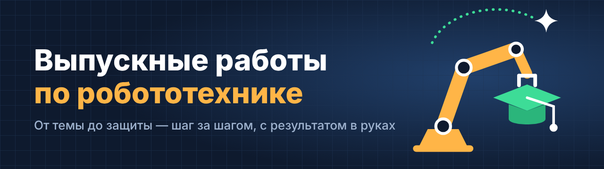

Здесь живут выпускные работы бакалавров по робототехнике и мехатронике. У каждой работы свой репозиторий: код, модели, расчёты, эксперименты и пояснительная записка — всё в одном месте, с историей того, как работа росла от идеи до защиты.

## С чего начать

1. **Примите приглашение** в организацию — оно приходит на почту, привязанную к GitHub.
2. **Создайте репозиторий** из шаблона: [diploma-template](https://github.com/vkr-robotics/diploma-template) → **Use this template** → Owner: `vkr-robotics`.
3. **Заполните README:** тема, цель, задачи. Это визитка работы — с неё начинается каждая встреча.

Уже есть свой репозиторий? Перенесите его: Settings → Danger Zone → Transfer ownership → `vkr-robotics`. Вы остаётесь администратором.

## Путь до защиты

| Этап | Когда | Что в репозитории |
|---|---|---|
| 🎯 Тема и ТЗ | октябрь — ноябрь | README с целью и задачами, ТЗ в `docs/` |
| 🔍 Обзор | ноябрь — декабрь | Анализ аналогов и литературы |
| ⚙️ Работающий минимум | к февралю | Сквозной результат, пусть грубый: модель считает, робот едет |
| 🧪 Эксперимент | март — апрель | Данные в `data/`, графики, сравнение с требованиями ТЗ |
| 📄 Записка | к концу апреля | Все главы, заключение, список литературы |
| 🎤 Предзащита | май | Доклад, презентация, метка `predzashchita` |
| 🎓 Защита | июнь | Финальная версия, метка `zashchita` |

## Как работаем

- **Встречаемся каждую неделю.** На встречу приходим с результатом — графиком, кодом, моделью, текстом. Показанное ценится выше рассказанного.
- **Коммитим хотя бы раз в неделю.** История коммитов — лучший отчёт о ходе работы.
- **Пишем понятные сообщения:** «Добавил расчёт привода», а не «update».
- **Храним исходники**, а не только результаты: CAD вместе с экспортом в STEP и PDF, код — с инструкцией по запуску.
- **Пишем текст по ходу работы**, а не в мае: закончили этап — написали главу.

Подробная памятка — в шаблоне: [КАК_ВЕСТИ_РЕПОЗИТОРИЙ.md](https://github.com/vkr-robotics/diploma-template/blob/main/docs/КАК_ВЕСТИ_РЕПОЗИТОРИЙ.md).

## 🏆 Зал славы

Здесь появятся работы, защищённые на «отлично», — с фото и видео результата. Место для вашей уже есть.

---

Научный руководитель — [shevchenko-robotics](https://github.com/shevchenko-robotics)
